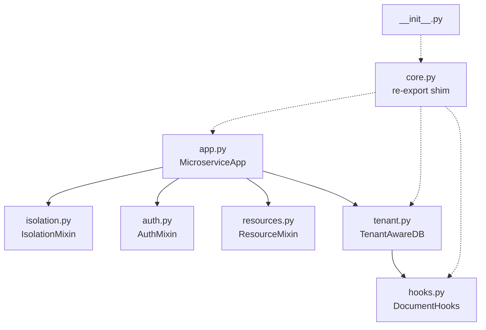

# Architecture & Isolation

## Package Structure

The `frappe_microservice` package is split into focused modules.
`core.py` is kept as a thin re-export layer so existing imports remain valid.

```
frappe_microservice/
├── __init__.py         # Public API surface
├── core.py             # Re-export shim (backward compat)
├── app.py              # MicroserviceApp class + create_microservice()
├── hooks.py            # DocumentHooks lifecycle system
├── tenant.py           # NullContext, get_user_tenant_id, TenantAwareDB
├── isolation.py        # IsolationMixin – app/module/hooks filtering
├── auth.py             # AuthMixin – OAuth2 & SID session validation
├── resources.py        # ResourceMixin – auto CRUD endpoint generation
├── controller.py       # DocumentController + registry
└── entrypoint.py       # create_site_config, run_app, main() (container entrypoint)
```

### Module Dependency Diagram



### Module Responsibilities

| Module | Owns |
|---|---|
| `hooks.py` | `DocumentHooks` – register/run lifecycle hooks per DocType |
| `tenant.py` | `TenantAwareDB`, `get_user_tenant_id`, `NullContext` |
| `isolation.py` | `IsolationMixin` – patches `frappe.get_installed_apps`, module maps, hooks resolution; DocType presync (`presync_service_doctypes`) |
| `auth.py` | `AuthMixin` – `_validate_oauth_token`, `_validate_session` |
| `resources.py` | `ResourceMixin` – `register_resource()` auto-CRUD |
| `policy.py` | `resolve_mode`/`resolve_bool` – shared off/warn/enforce flag parsing |
| `app.py` | `MicroserviceApp` (composed from the mixins) and `create_microservice()` |
| `cli.py` | `frappe-ms` CLI (`migrate`, `worker`) |
| `core.py` | Re-exports everything for backward compatibility |
| `entrypoint.py` | `create_site_config`, `run_app`, `main()` (container entrypoint: SERVICE_PATH, SERVICE_APP) |

### Startup DocType sync

At container startup `entrypoint.main()` calls
`isolation.presync_service_doctypes()` once (before Gunicorn forks workers); dev
mode (`app.run()`) syncs lazily on the first request. In the default
`DOCTYPE_SYNC_MODE=migrate`, changed DocType JSONs update both `tabDocType`
metadata and the SQL table schema additively (`tenant_id` is never dropped);
`create` reproduces the legacy create-only behavior. Concurrent replicas are
serialized by a DB advisory lock. See the README "Schema sync" section.

## Bounded Context

In a true microservices architecture, each service must own its data. The Frappe Microservice Framework promotes this by encouraging an **Independent Database** for each service.

- **Central Site**: Acts as the "Source of Truth" for authentication and global user state.
- **Service Database**: Contains only the DocTypes relevant to the service's bounded context.

## External Dependencies

### Central Site & the tenancy provider contract

In multi-tenant mode the framework expects the **Central Site** to run an app
providing tenancy. It does not depend on any particular implementation — only on
this contract:

- **Tenant identification**: a `tenant_id` field on the `User` DocType.
- **Column presence**: a `tenant_id` column on the tables services read and
  write. Frappe keeps `tenant_id` outside DocType metadata, so a provider
  typically adds it with an `ALTER TABLE` patch across every non-single DocType.
- **Session validation**: the session-validation response includes the user's
  `tenant_id`, so a microservice can resolve the tenant from a session alone.

Any app meeting that contract works. Without one, multi-tenant isolation cannot
function: a service cannot resolve a user's tenant, and tenant-scoped writes fail
because the column is absent.

**Single-tenant mode.** Set `MULTI_TENANT=0` and none of the above applies. The
framework resolves, filters on, writes and verifies no `tenant_id` at all, and
runs against a stock Frappe/ERPNext site. Role permissions are unaffected and
still enforced. This is the mode the integration suite runs in, which is why it
needs no proprietary image.

## Strategy: Granular Decomposition of ERPNext

One of the primary goals of this framework is to enable the **gradual decomposition of monolithic ERPNext** into smaller, manageable microservices.

Instead of a high-risk "big bang" migration, teams can:
1.  **Identify a Module**: Choose a specific module (e.g., "Orders", "Signups", "Inventory").
2.  **Define a Bounded Context**: Extract relevant DocTypes to a new service-specific database.
3.  **Implement via Framework**: Use the Frappe Microservice Framework to expose APIs and business logic.
4.  **Secure Integration**: Leverage the Central Site for unified authentication across all microservices.

This approach allows for independent scaling, faster deployment cycles, and technology diversification while maintaining the power of Frappe's DocType system.

## Multi-Tenancy

The framework is built for SaaS applications. It assumes a "Single Site, Multi-Tenant" model where data is isolated using a `tenant_id` field.

### TenantAwareDB

The `app.tenant_db` object is a wrapper around Frappe's database methods. It automatically ensures that:
1.  **Filtering**: All `get_all` calls include a `tenant_id` filter in the `WHERE` clause.
2.  **Validation**: All `get_doc` calls verify that the requested document belongs to the current user's tenant.
3.  **Inheritance**: All `insert_doc` calls automatically set the `tenant_id` from the current request context.

### Authentication & Identification

1.  A user logs in to the **Central Site**.
2.  The microservice receives the request with the `sid` cookie.
3.  `MicroserviceApp` validates the session against the Central Site.
4.  The user's `tenant_id` is resolved and stored in the request context (`flask.g`).
5.  All database operations are now scoped to that `tenant_id`.

## Database Diagram (Example)


