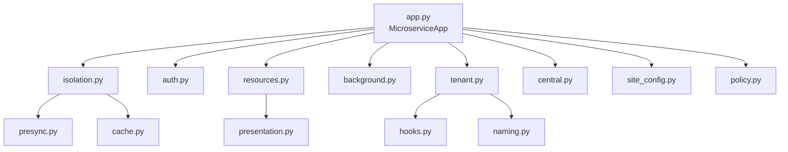
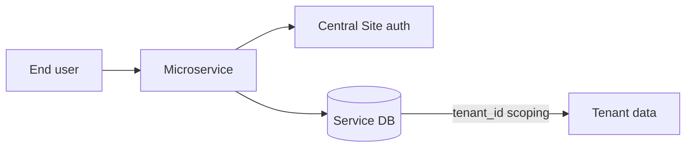

# Architecture & Isolation

## The problem this solves

A Frappe app expects to be one of several apps installed on one site, sharing one
database, one Redis, and one hooks registry. A microservice needs the opposite:
its own database, its own schema, and no visibility into other services' apps.

The framework reconciles the two by patching Frappe's app- and module-resolution
at startup so a service sees only itself plus the framework apps it declares —
without forking Frappe or changing how you write DocTypes and controllers.

## Package structure

```
frappe_microservice/
├── __init__.py        # public API surface
├── core.py            # re-export shim (backward compatibility)
├── app.py             # MicroserviceApp + create_microservice()
├── auth.py            # AuthMixin — OAuth2 / SID / internal-token validation
├── background.py      # BackgroundTaskMixin — embedded RQ worker
├── cache.py           # Redis key namespacing for a shared cache
├── central.py         # CentralSiteClient (app.central)
├── cli.py             # `frappe-ms` CLI
├── controller.py      # DocumentController + registry
├── entrypoint.py      # container entrypoint (SERVICE_PATH / SERVICE_APP)
├── hooks.py           # DocumentHooks lifecycle system
├── isolation.py       # IsolationMixin — app/module/hook filtering
├── naming.py          # tenant-scoped docnames, resolve-or-create
├── policy.py          # resolve_mode / resolve_bool flag parsing
├── presentation.py    # Link-value label presentation
├── presync.py         # startup DocType schema + fixture sync
├── resources.py       # ResourceMixin — register_resource() auto-CRUD
├── site_config.py     # site_config.json generation
├── tenant.py          # TenantAwareDB, tenant resolution
└── utils.py
```

Everything public is importable from both `frappe_microservice` and
`frappe_microservice.core`; the latter is a compatibility shim.



| Module | Owns |
|---|---|
| `app.py` | `MicroserviceApp` (composed from the mixins), `create_microservice()`, `secure_route`, middleware |
| `auth.py` | OAuth2 Bearer, Frappe `sid` session, and `X-Internal-Token` validation |
| `background.py` | Embedded RQ worker thread and `enqueue_task` |
| `cache.py` | Prefixes cache keys so services can share one Redis |
| `central.py` | `CentralSiteClient` — service→Central Site calls |
| `controller.py` | Frappe-style `DocumentController` classes and discovery |
| `hooks.py` | `DocumentHooks` — register/run lifecycle hooks per DocType |
| `isolation.py` | Patches `frappe.get_installed_apps`, module maps and hook resolution |
| `naming.py` | Tenant-scoped docnames; `resolve_or_create` for master doctypes |
| `policy.py` | Shared `off`/`warn`/`enforce` and boolean flag parsing |
| `presentation.py` | Presents renamed-master Link values as their labels |
| `presync.py` | Startup DocType schema sync and fixture import |
| `resources.py` | `register_resource()` auto-CRUD endpoints |
| `site_config.py` | Generates `site_config.json` from the environment |
| `tenant.py` | `TenantAwareDB`, tenant resolution, `tenant_id` stamping |

## Bounded context

Each service owns its data. The Central Site remains the authority for
authentication and global user state; the service database holds only the
DocTypes in that service's bounded context.

```yaml
services:
  orders-service:
    image: ghcr.io/vyogotech/erpnext-microservices-lib:latest
    environment:
      DB_HOST: orders-db
      CENTRAL_SITE_URL: http://central-site:8000
    depends_on: [orders-db]

  orders-db:
    image: mariadb:10.6
    environment:
      MYSQL_DATABASE: orders_db
      MYSQL_USER: orders_user
      MYSQL_PASSWORD: orders_pass
```

## App and module isolation

A service container may have `frappe` and `erpnext` installed but must not load
another service's app hooks. `IsolationMixin` patches Frappe so that:

- `frappe.get_installed_apps()` returns only the allowed set (the framework apps
  declared via `load_framework_hooks`, plus this service's own app).
- Module maps resolve only to modules the container can actually import.
- Hook resolution skips paths belonging to non-allowed apps, rather than raising
  `ModuleNotFoundError` when the Central Site's apps appear in a shared cache.

A broken import *inside* an allowed app still propagates — that is a real bug and
is deliberately not swallowed as a skipped hook.

### Shared Redis cache

Frappe prefixes cache keys with the database name. Services sharing a database
name would therefore collide on keys like `app_hooks` or `doctype_meta:<doctype>`.
The framework patches `RedisWrapper.make_key` at startup to add the service name
to every non-shared key, so several services and the Central Site can share one
Redis instance safely. Keys explicitly requested with `shared=True` bypass
namespacing and reach the global namespace.

## Startup schema sync

At container startup `entrypoint.main()` runs `presync_service_doctypes()` once,
before Gunicorn forks workers; in dev (`app.run()`) it syncs lazily on the first
request. `DOCTYPE_SYNC_MODE` selects the behaviour — see
[Schema sync](configuration.md#schema-sync).

Concurrent replicas are safe: the sync body takes a database advisory lock
(MariaDB `GET_LOCK`, Postgres `pg_advisory_lock`), and a replica that cannot
acquire it within 120s skips the sync rather than crashing. For operators who
prefer an explicit migration step, `frappe-ms migrate` runs the same sync and
suits a Kubernetes Job.

## Tenancy

The framework supports a **single site, multi-tenant** model where rows carry a
`tenant_id`, and an equally first-class **single-tenant** mode where they do not.
See [Tenancy](tenancy.md) for the modes, the Central Site contract and how to
choose.

In multi-tenant mode, `app.tenant_db` ensures:

1. **Filtering** — reads (`get_all`, `count`, `exists`, `get_value`) carry a
   `tenant_id` filter.
2. **Verification** — `get_doc` confirms the document belongs to the current
   tenant before returning it.
3. **Stamping** — `insert_doc` sets `tenant_id` from the request context.

### Request flow



1. The user authenticates against the **Central Site**.
2. The microservice receives the request with a `sid` cookie or Bearer token.
3. `secure_route` validates the session against the Central Site.
4. In multi-tenant mode the user's `tenant_id` is resolved into `flask.g`.
5. Database operations through `app.tenant_db` are scoped accordingly.

## Decomposing an ERPNext monolith

The framework exists to make decomposition incremental rather than a big-bang
migration:

1. **Identify a module** — Orders, Inventory, HR.
2. **Define its bounded context** — move the relevant DocTypes to a service database.
3. **Build the service** — expose APIs and business logic with this framework.
4. **Keep auth unified** — the Central Site stays the single point of entry.
5. **Scale independently** — give order processing more replicas than the rest.

Each extraction is reversible and independently deployable, which is what keeps
the risk bounded.
